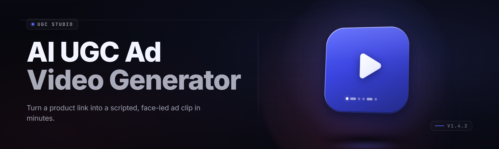

  
  
  

  

  
  
  

---

**Turn a product URL and a hook into 40 scroll-stopping UGC-style video ads — no actors, no camera, no editor.**

The AI UGC Ad Video Generator is a desktop toolkit that writes the script, clones a presenter, renders the b-roll, and exports platform-ready MP4s for TikTok, Reels, and Shorts. One `.exe`. Extract, run, batch out a week of creative in an afternoon.

---

## 📥 Download

Grab the latest Windows release, extract the archive, and run the `.exe`. No Python, no Node, no build step — it's a single self-contained app.

  

---

## 📋 Table of Contents

- [Overview](#-overview)
- [What Is the AI UGC Ad Video Generator](#-what-is-the-ai-ugc-ad-video-generator)
- [Tips for Best Results](#-tips-for-best-results)
- [Quick Start](#-quick-start)
- [The Problem](#-the-problem)
- [The Solution](#-the-solution)
- [Feature Modules](#-feature-modules)
- [Module Catalog](#-module-catalog)
- [Known Issues](#-known-issues)
- [Usage Guidelines](#-usage-guidelines)
- [Installation](#-installation)
- [Compatibility & Platform Support](#-compatibility--platform-support)
- [FAQ](#-faq)
- [Download the Toolkit](#-download-the-toolkit)

---

## 🧭 Overview

| Category | Details |
|---|---|
| **Product** | AI UGC Ad Video Generator |
| **Type** | Desktop creative suite (Windows `.exe`) |
| **Core output** | Vertical MP4 ads (9:16), 15–60s, TikTok / Reels / Shorts ready |
| **Inputs** | Product URL, brand kit, hook angle, optional voice preset |
| **Models** | Script LLM, TTS voice engine, face-clone presenter, b-roll generator |
| **Batch mode** | Up to 40 variants per session |
| **License** | MIT — free for personal and commercial creative work |

The toolkit collapses the whole UGC ad pipeline — hook ideation, scriptwriting, presenter generation, voiceover, b-roll, captions, and export — into one queue you can fire off and walk away from. You supply the angle; it supplies the rest of the creative.

---

## 🎥 What Is the AI UGC Ad Video Generator

| Term | Explanation |
|---|---|
| **UGC-style ad** | A short-form video that mimics a real customer talking to camera about a product — not a polished studio spot. |
| **Hook** | The first 1–3 seconds that stop the scroll. The generator models hundreds of hook archetypes. |
| **Presenter clone** | A synthesized on-camera persona (built from a licensed avatar library or your own consented footage) that reads the script. |
| **B-roll** | Cutaway footage of the product, hands, unboxing, and lifestyle shots stitched under the voiceover. |
| **Angle** | The emotional or logical frame for the ad: problem/solution, testimonial, before/after, us-vs-them. |
| **Batch variant** | One product + one angle → many hook/pace/voice permutations for A/B testing. |
| **Compliance pass** | A rules check that flags claims, banned phrases, and platform-restricted wording before export. |

Why creators reach for it:

- 🎯 **Hook-first writing** — every script is built around a tested scroll-stopper, not a generic pitch.
- 🗣️ **Presenter + voice in one pass** — talking-head and voiceover come out synced, not bolted together.
- 📦 **Batch by default** — 40 variants instead of 1, so your ad account never runs dry.
- ⏱️ **Minutes, not days** — a full ad from URL to export in under 4 minutes on a mid-range GPU.
- 🧩 **Brand-consistent** — logo, colors, font, and CTA locked across every export.

---

## 💡 Tips for Best Results

- Keep the hook under 12 words — the presenter should land the pitch before the 2-second mark.
- Feed the generator a real product URL, not a homepage; it pulls specs, price, and reviews for grounding.
- Use one angle per batch. Mixing angles in a single batch muddles the variants and your A/B signal.
- Render at 1080×1920 minimum. Downscaling a 4K master keeps captions crisp on older phones.
- Enable the compliance pass *before* export, not after — retro-fixing a flagged claim wastes a render.
- Lock a brand kit once and reuse it; free-typed colors drift between sessions and break consistency.
- Cap batch size at 25 per GPU session. Beyond that, thermal throttling slows renders more than it helps.
- Keep presenter faces diverse across variants — same-face batches fatigue fast on paid social.
- Add captions every time. 60%+ of short-form is watched muted, and burned-in captions outperform overlays.
- Test hooks, not voices. Voice changes move a few percent; hook changes move a whole campaign.

---

## ⚡ Quick Start

1. 📦 **Get the app** — visit the project page, download the release archive, and extract it to a folder you own.
2. ▶️ **Run the `.exe`** — double-click to launch. First run unpacks the model cache locally (~2.1 GB).
3. 🎛️ **Build a project** — paste your product URL, pick an angle, and paste or type your brand kit.
4. 🗣️ **Choose a presenter + voice** — pick from the avatar library or load a consented face-clone and a voice preset.
5. 🚀 **Generate the batch** — hit Render, set variant count, and let it export MP4s to your output folder.

That's the whole loop. No terminal, no config files to hand-edit, no dependency wrangling.

---

## 🩹 The Problem

- **Creative burnout is real.** UGC ads need a fresh hook every few days, and human creators can't shoot that fast.
- **Actors are expensive.** A single talking-head shoot costs more than a month of tooling and takes weeks to schedule.
- **Editing is the bottleneck.** Cutting b-roll, syncing voice, burning captions, and resizing for three platforms eats whole days.
- **Variation is manual.** A/B testing needs 20+ variants; making them by hand is a full-time job.
- **Platform rules shift.** Claims that worked last quarter get flagged this quarter, and nobody tracks the diff.
- **Brand drift.** Ten freelancers produce ten visual styles, and your feed stops looking like one brand.
- **Tool sprawl.** Script tool + TTS tool + presenter tool + editor + resizer = five subscriptions and five logins.

---

## ✅ The Solution

| Problem | How the Toolkit Solves It |
|---|---|
| Creative burnout | Hook archetype library + LLM scripting generates fresh angles on demand. |
| Actor cost | Presenter clone library renders a talking head from text, no shoot required. |
| Editing bottleneck | One pipeline auto-cuts b-roll, syncs voice, burns captions, and exports all ratios. |
| Manual variation | Batch mode produces up to 40 variants per session with one click. |
| Shifting rules | Compliance pass re-checks claims against an updated platform-rules pack. |
| Brand drift | Locked brand kit enforces logo, palette, font, and CTA on every export. |
| Tool sprawl | Single `.exe` bundles script, voice, presenter, b-roll, editor, and exporter. |

---

## 🧱 Feature Modules

### 🎬 Scripting & Hooks

- **Hook Archetype Engine** — 320+ tested scroll-stopper templates, ranked by niche fit.
- **Angle Selector** — problem/solution, testimonial, before/after, us-vs-them, and 9 more.
- **CTA Writer** — closes every script with a platform-aware call to action.
- **Claim Grounding** — pulls real specs and reviews from the product URL so scripts stay factual.
- **Tone Dial** — casual, urgent, warm, or deadpan — shifts the whole script register.

### 🗣️ Voice & Presenter

- **Voice Engine** — 48 preset voices across accents, ages, and energy levels.
- **Consented Face-Clone** — build a presenter from footage you own and have rights to.
- **Lip-Sync Pass** — phoneme-accurate mouth motion synced to the generated voiceover.
- **Gesture Layer** — idle motion, blinks, and hand emphasis so the presenter isn't a mannequin.
- **Presenter Diversity Pack** — mixed faces and ages to keep feeds from fatiguing.

### 🎞️ B-Roll & Visuals

- **B-Roll Generator** — product, unboxing, hands-on, and lifestyle shots stitched under the script.
- **Scene Matcher** — aligns each b-roll clip to the sentence it illustrates.
- **Caption Burner** — word-by-word captions in your brand font, tuned for muted viewing.
- **Transition Pack** — hard cut, swipe, zoom-punch, and match-cut presets.
- **Music Bed** — royalty-cleared tracks matched to the ad's energy curve.

### 📦 Batch & Export

- **Batch Runner** — 40 variants per session, queued and rendered unattended.
- **Ratio Exporter** — 9:16, 1:1, and 16:9 from a single master render.
- **Preset Profiles** — TikTok, Reels, Shorts, and paid-social export presets.
- **Variant Namer** — auto-tags exports by hook, angle, and voice for clean A/B tracking.
- **Output Manifest** — CSV of every variant with its settings for your ad tracker.

### 🛡️ Compliance & Brand

- **Compliance Pass** — flags banned phrases and restricted claims before export.
- **Brand Kit Lock** — palette, logo, and font enforced across the batch.
- **Rules Pack Updater** — pulls the latest platform-rules pack on launch.
- **Watermark Toggle** — burn a draft watermark on unreviewed exports.

---

## 🗂️ Module Catalog

| Module | Status | Description |
|---|---|---|
| Hook Archetype Engine | ✅ Working | 320+ ranked scroll-stopper templates. |
| Angle Selector | ✅ Working | 13 emotional/logical ad frames. |
| CTA Writer | ✅ Working | Platform-aware closing call to action. |
| Claim Grounding | ✅ Working | Pulls real specs/reviews from URL. |
| Tone Dial | ✅ Working | Casual → urgent → deadpan register shift. |
| Script LLM | ✅ Working | Generates full 15–60s scripts. |
| Voice Engine | ✅ Working | 48 preset voices, multi-accent. |
| Consented Face-Clone | ✅ Working | Presenter from owned footage. |
| Lip-Sync Pass | ✅ Working | Phoneme-accurate mouth motion. |
| Gesture Layer | ✅ Working | Blinks, idle motion, hand emphasis. |
| Presenter Diversity Pack | ✅ Working | Mixed faces/ages library. |
| B-Roll Generator | ✅ Working | Product/unboxing/hands-on shots. |
| Scene Matcher | ✅ Working | Aligns clips to sentences. |
| Caption Burner | ✅ Working | Word-by-word brand-font captions. |
| Transition Pack | ✅ Working | Cut, swipe, zoom-punch, match-cut. |
| Music Bed | ✅ Working | Cleared tracks by energy curve. |
| Sound Design Layer | ✅ Working | Whooshes, pops, and stingers. |
| Batch Runner | ✅ Working | 40 variants unattended. |
| Ratio Exporter | ✅ Working | 9:16, 1:1, 16:9 from master. |
| Preset Profiles | ✅ Working | TikTok/Reels/Shorts/paid-social. |
| Variant Namer | ✅ Working | Auto-tags hook/angle/voice. |
| Output Manifest | ✅ Working | CSV of every variant's settings. |
| Compliance Pass | ✅ Working | Banned-phrase and claim flags. |
| Brand Kit Lock | ✅ Working | Palette/logo/font enforcement. |
| Rules Pack Updater | ✅ Working | Latest platform-rules pack. |
| Watermark Toggle | ✅ Working | Draft watermark on unreviewed. |
| GPU Accelerator | ✅ Working | CUDA/DirectML render path. |
| Model Cache Manager | ✅ Working | Local model storage + cleanup. |
| Project Save/Load | ✅ Working | Portable `.ugcproj` project files. |
| Render Queue | ✅ Working | Pause, resume, reorder jobs. |
| A/B Tracker Handoff | ✅ Working | Export metadata to ad platforms. |
| Auto-Reframe | ✅ Working | Subject-tracking crop for each ratio. |
| Subtitle Importer | ✅ Working | SRT/VTT in, burned captions out. |
| Localization Pass | ✅ Working | Multi-language script + voice. |
| Preview Scrubber | ✅ Working | Frame-accurate timeline scrub. |
| One-Click Presets | ✅ Working | Beginner "just make an ad" mode. |
| Crash-Safe Autosave | ✅ Working | Recovers in-progress sessions. |

---

## ⚠️ Known Issues

| Issue | Solution |
|---|---|
| First launch slow on cold cache | Expected — model unpack (~2.1 GB) runs once, then launches are fast. |
| Lip-sync jitter on very fast speech | Cap script pace in the Tone Dial or shorten sentences; the phoneme pass is tuned to ~4.5 words/sec. |
| Face-clone rejected on upload | The clone requires consent-verified footage; check the rights checklist in the presenter panel. |
| Render fails on 4 GB VRAM GPUs | Drop batch size or switch to the DirectML CPU fallback in Settings → Render. |
| Compliance flags a benign claim | Add the phrase to your allowlist in Settings → Compliance if it's accurate for your product. |
| Captions clipped at export | Set safe-margin to 8% for TikTok; the default 4% trims under the UI overlay. |

---

## 🧾 Usage Guidelines

| Allowed | Not allowed |
|---|---|
| Researching hook and angle performance for your own products | Cloning a real person's face or voice without documented consent |
| Generating ads for products you sell or promote | Generating misleading claims about health, finance, or safety |
| Using licensed avatars and royalty-cleared music | Redistributing the bundled model weights as your own product |
| Batching variants for legitimate A/B testing | Circumventing a platform's disclosure rules for AI-generated media |
| Local, offline rendering on your own machine | Using the tool to impersonate a brand or public figure |

> AI-generated ads must be disclosed where platform rules require it. You are responsible for the truthfulness of every claim your scripts make.

---

## 🛠️ Installation

1. **Download the release** — from the project page, grab the latest Windows archive for the AI UGC Ad Video Generator.
2. **Extract it** — right-click the archive and extract to a folder you own (avoid Program Files; the app writes a model cache next to itself).
3. **Run the `.exe`** — double-click the executable. On first launch, allow the model cache to unpack, then create your first project.

No admin rights required for normal use. The app keeps everything inside its own folder — no registry writes, no system-wide changes.

---

## 🖥️ Compatibility & Platform Support

| Component | Minimum | Recommended |
|---|---|---|
| OS | Windows 10 (21H2, x64) | Windows 11 (23H2, x64) |
| CPU | 4-core / 2.5 GHz | 8-core / 3.5 GHz+ |
| RAM | 8 GB | 16 GB+ |
| GPU | 4 GB VRAM (DirectML) | 8 GB+ VRAM (CUDA) |
| Storage | 6 GB free | 15 GB SSD |
| Display | 1280×720 | 1920×1080+ |

| Platform | Export Support |
|---|---|
| TikTok | ✅ 9:16, disclosure toggle |
| Instagram Reels | ✅ 9:16, safe-margin preset |
| YouTube Shorts | ✅ 9:16 |
| Facebook Feed | ✅ 1:1, 16:9 |
| Paid social (Meta/Google) | ✅ all ratios + manifest export |

---

## ❔ FAQ

| Question | Answer |
|---|---|
| Do I need a GPU to run it? | No — there's a DirectML/CPU fallback — but a CUDA GPU cuts render time dramatically. |
| Do I need internet after install? | Only for the rules-pack updater and the product-URL grounding; rendering is fully offline. |
| Can I use my own face and voice? | Yes, with documented consent — the presenter panel has a rights checklist you must pass. |
| How long does one ad take to render? | ~3–4 minutes for a 30s ad on a mid-range GPU; batching amortizes setup across variants. |
| Are the voices and music royalty-cleared? | Yes — all bundled voices and tracks ship cleared for commercial ad use. |
| Can I export for paid-social campaigns? | Yes — 1:1 and 16:9 presets plus a CSV manifest for your ad tracker. |
| Does it watermark my exports? | Only if you toggle the draft watermark; finished exports are clean. |
| Where do my projects and exports live? | Inside the app folder by default, or any output path you set in Settings → Output. |
| What if a render crashes mid-batch? | Crash-safe autosave recovers the session and re-queues unfinished variants. |
| Is there a beginner mode? | Yes — One-Click Presets skips angle and voice config and just makes a solid ad. |

---

## 📥 Download the Toolkit — 2026 Release

The AI UGC Ad Video Generator ships as a single Windows app: download the archive, extract it, and run the `.exe`. Everything — scripting, presenter, voice, b-roll, captions, and export — is bundled. No runtime to install, no source to compile, no subscription attached.

  

Built for creators who ship ads daily and test relentlessly. Point it at a product, pick an angle, and let the batch run while you do something else. The scroll is brutal out there — this stack just makes sure you always have a fresh hook in the chamber.
